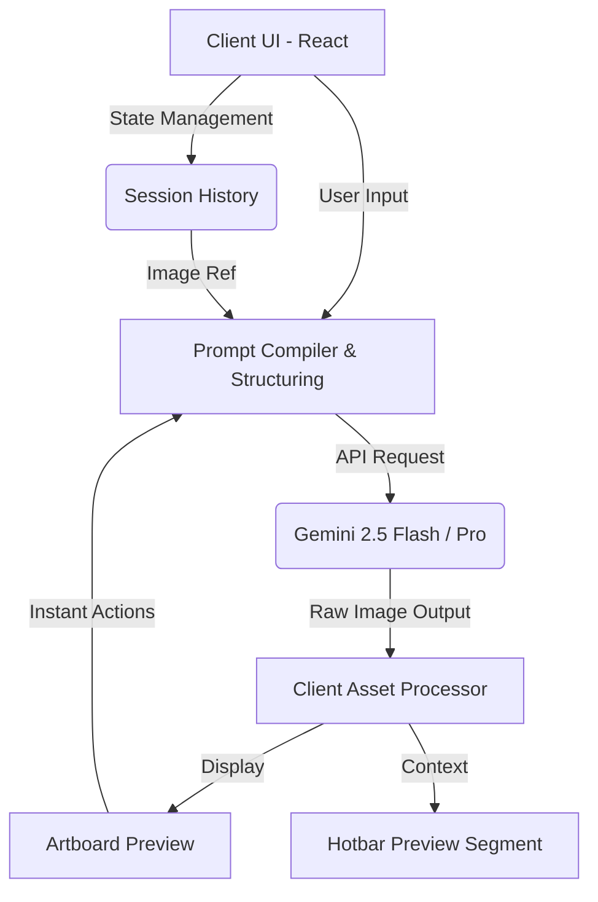

# ItemSprite Forge
> Asset Generation & Refinement Engine

 *(Placeholder: Replace with GIF of generation and refinement loop)*

## 1. Product Overview

ItemSprite Forge is a dedicated 16x16 asset generation and editing environment. It enables technical artists and developers to rapidly prototype, refine, and export game-ready sprites through a deterministic human-in-the-loop AI pipeline.

### Core Value Proposition
Reduce the asset creation cycle from hours to minutes by blending text-to-image capabilities with strict structural constraints (pixelation, palette enforcement, scale framing). Instead of treating generation as a single shot, the tool acts as a version-controlled forge for iterative asset mutation.

---

## 2. Architecture & Tech Stack

The application is built on a client-side architecture using React and Tailwind CSS, leveraging the Gemini API for vision and text operations.



### Components
*   **React 18 & Vite**: Client-side rendering and module bundling.
*   **Tailwind CSS**: Strict styling system with custom CSS variables for bespoke aesthetic control.
*   **Motion**: State-driven layout animations.
*   **Gemini SDK (`@google/genai`)**: Core multimodal endpoint utilizing `gemini-2.5-flash` for rapid iteration and `gemini-2.5-pro` for complex logic reasoning.

---

## 3. User Flow

The application enforces a non-linear but highly structured workflow.

1.  **Initialization**: 
    The user inputs a natural language (NL) prompt (e.g., "A raw emerald ore chunk with stone debris") describing the item they want to forge, or uploads an initial reference image.
2.  **Configuration (Settings)**: 
    The user configures structural and aesthetic settings from the sidebar (e.g., AI Model tier, overall complexity, orientation, outline style). These chosen settings automatically strictly format and condition the final prompt sent to the AI.
3.  **Generation (The Forge)**: 
    The request is compiled and sent. The resulting asset is loaded onto the primary Artboard as the first version in the item's history structure.
4.  **Refinement Loop (Iterative Versioning)**:
    *   **Variant Generation**: Create a sibling version using the same prompt and settings but an altered seed/temperature path.
    *   **Touch-Up**: The user specifies a corrective natural language prompt (e.g., "Make the sword blade slightly longer and thinner") to apply a delta to the current version, outputting a new iteration.
    *   **Instant Actions**: Deterministic operations (Simplify, Symmetry, Maximize, Fix Outline) are applied instantly via automated prompt wrappers, acting as one-click modifiers that yield new versions.
    *   **History Navigation**: The user can scrub through a linear history track of generated versions, allowing them to switch back to and branch off of previous iterations if a refinement strays too far.
5.  **Validation**:
    The active asset version is previewed dynamically in the "In-Game Hotbar" component against standard generic game backgrounds to verify contrast and readability.
6.  **Export**: 
    The finalized sprite is downloaded as a web-optimized, transparent `.png` ready for commercial or personal engine use.

---

## 4. Prompt Engineering Strategies

The core of ItemSprite Forge relies on heavily constrained system instructions rather than unstructured natural language. We take the user's base NL prompt and heavily augment it under the hood.

### A. Strict Typology Enforcement
The system prompt strictly demands a `16x16` pixel-art aesthetic. We use constraints like:
> *"Output strictly a 16x16 pixel art sprite on a pure white or pure black background. Use a strict, limited color palette."*

### B. The "Instant Action" Wrappers
Instead of relying on the user to understand pixel-art terminology, we map UI buttons to highly specific, under-the-hood instructional patches.
*   **Simplify**: *"Clean up noise. Reduce the total number of colors. Merge stray pixels into clusters. Do not increase detail level."*
*   **Maximize**: *"Increase the size of the item. Make it touch the edges of the 16x16 frame. Remove empty padding around the item."*
*   **Symmetry**: *"Enforce geometric symmetry on the silhouette. Ensure left and right sides match shape. Maintain top-left lighting."*
*   **Fix Outline**: *"Regenerate the outline using Jappa-style logic (darkened inner colors)."*

### C. Multi-Modal Context Passing (Variant/Touch-Up)
When a user requests a variant, the current sprite is passed explicitly as an `Image` part in the Gemini request alongside text detailing the delta.
*   **Refine Path**: We pass the current visual state and prompt the model to treat it as the absolute base, requiring it to calculate the delta based on the user's specific instruction (e.g., "Make the blade longer").
*   **Remix Path**: We pass the current visual state but instruct the model to treat it as a stylistic influence rather than a rigid structural base.

---

## 5. Development Setup

### Pragmatic Quickstart

1.  **Install dependencies**:
    ```bash
    npm install
    ```
2.  **Environment Variables**:
    Create a `.env` file at the root. You must supply your own Gemini API key for local development.
    ```env
    VITE_GEMINI_API_KEY=your_api_key_here
    ```
3.  **Run the dev server**:
    ```bash
    npm run dev
    ```
4.  **Build for Production**:
    ```bash
    npm run build
    ```

---

## 6. License

Copyright (c) 2026 mfishma

This project is licensed under a custom **Attribution-NonCommercial** license based on the MIT License structure. 

This means that you are free to use, modify, and distribute the code for **personal or educational purposes** as long as you provide visible credit (attribution). However, you **may not use this code for commercial purposes** or monetary gain. 

See the [LICENSE.md](LICENSE.md) file for more details.
